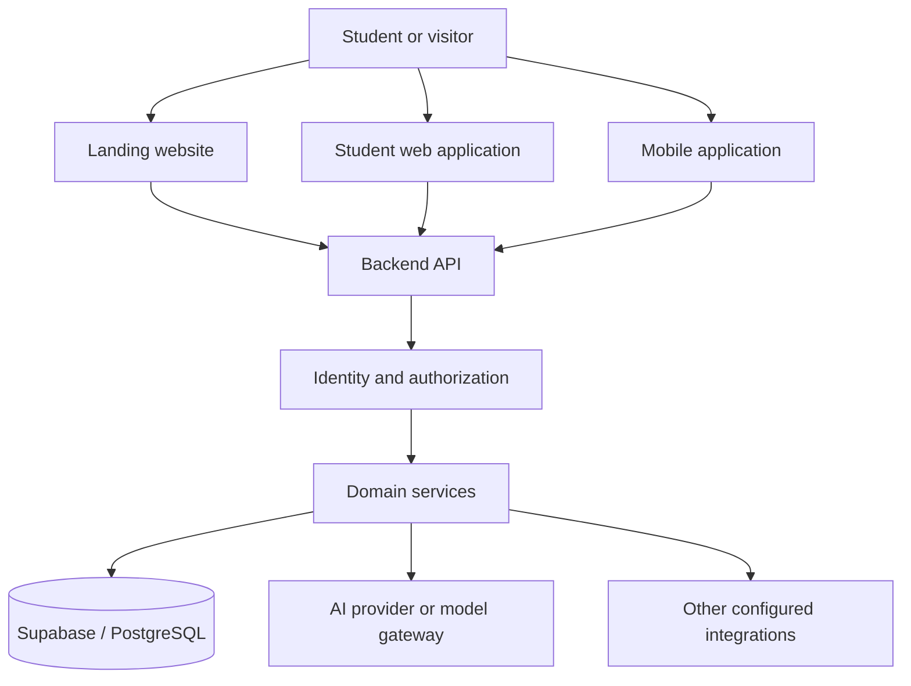
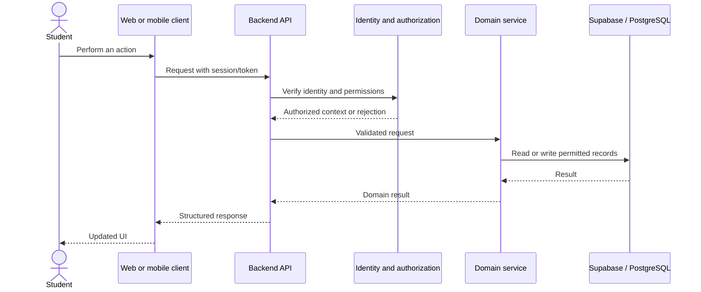
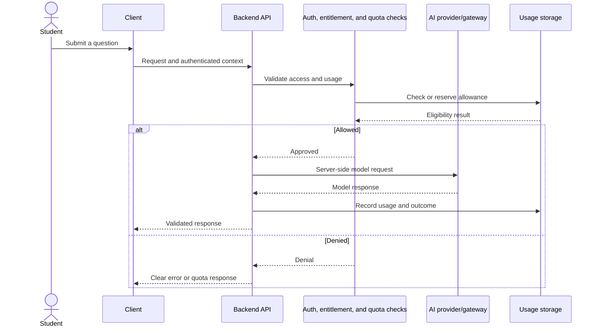
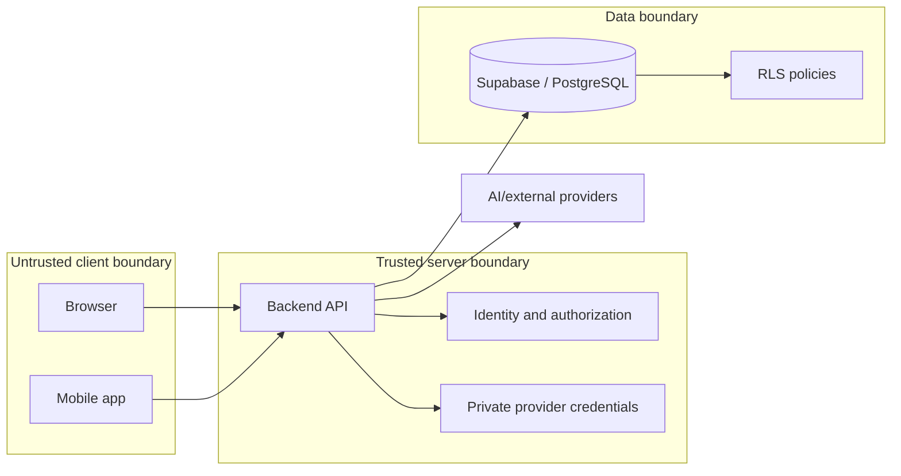
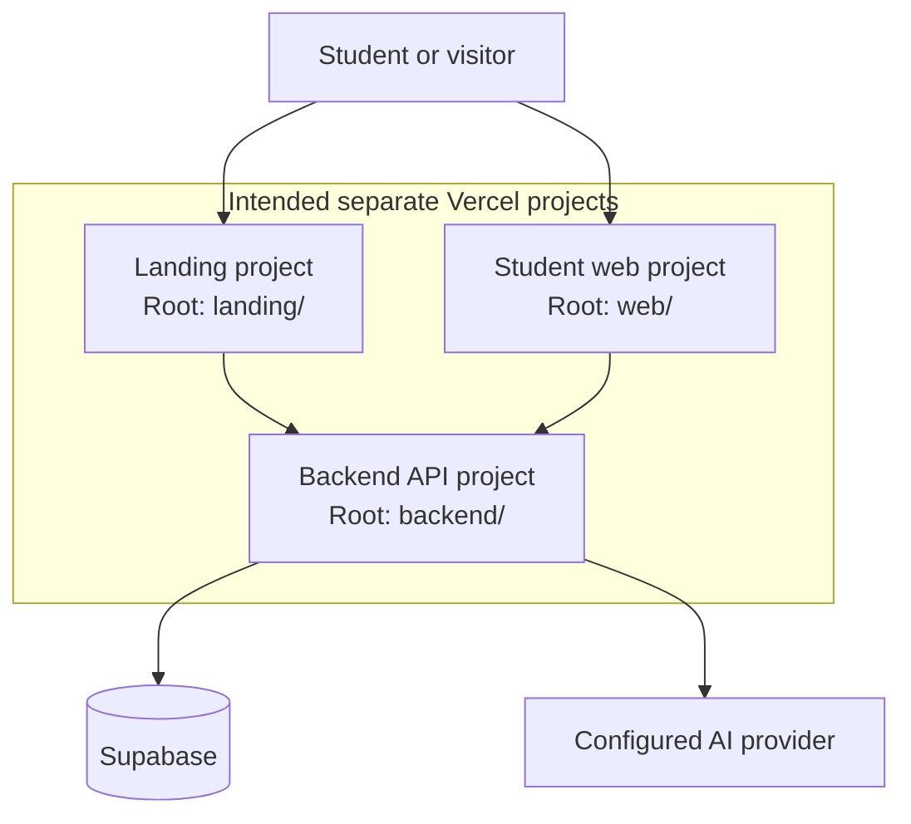

# SharpMind — System Architecture

> **Status:** Architecture reference based on available SharpMind project context and previously reviewed repository/deployment notes. Verify all items marked _verify in source_ against the current checkout. Local configuration does not prove live production status.

## Contents

1. [Purpose and evidence](#1-purpose-and-evidence)
2. [System overview](#2-system-overview)
3. [Repository layout](#3-repository-layout)
4. [Application boundaries](#4-application-boundaries)
5. [Core data flows](#5-core-data-flows)
6. [Backend architecture](#6-backend-architecture)
7. [Identity and authorization](#7-identity-and-authorization)
8. [Database and Supabase](#8-database-and-supabase)
9. [AI architecture and usage controls](#9-ai-architecture-and-usage-controls)
10. [Environment and secrets](#10-environment-and-secrets)
11. [Deployment topology](#11-deployment-topology)
12. [Security requirements](#12-security-requirements)
13. [Testing and quality gates](#13-testing-and-quality-gates)
14. [Local development workflow](#14-local-development-workflow)
15. [Verification checklist and risks](#15-verification-checklist-and-risks)
16. [Architecture principles](#16-architecture-principles)
17. [Glossary](#17-glossary)

## 1. Purpose and evidence

SharpMind is an educational platform intended to help students study, practise, revise, plan work, and receive AI-assisted learning support. Project context describes a multi-package repository with web applications, a backend/API, shared packages, and a mobile application area.

This document describes the known architecture and the intended boundaries. It is not a claim that every feature is complete or deployed.

- **Known from project context:** described in earlier project work or repository/deployment notes.
- **Verify in source:** inspect the current code, manifests, migrations, tests, and configuration.
- **Deployment-dependent:** requires access to the actual Vercel, DNS, Supabase, or provider environment.

## 2. System overview

### Main components

| Component                 | Responsibility                                      | Verification                                               |
| ------------------------- | --------------------------------------------------- | ---------------------------------------------------------- |
| `landing/`                | Public product website                              | Confirm current routes and build configuration             |
| `web/`                    | Student-facing web application                      | Confirm implemented learning flows                         |
| `backend/`                | API and trusted server-side operations              | Confirm routes, middleware, and services                   |
| `apps/*`                  | Additional apps; mobile may be included             | Confirm exact package and framework                        |
| `packages/*`              | Shared code and internal libraries                  | Confirm package names and dependencies                     |
| Supabase                  | Database and potentially auth/storage services      | Inspect schema, migrations, policies, and enabled services |
| AI provider/model gateway | AI model integration                                | Inspect adapters, model selection, and usage enforcement   |
| Vercel                    | Intended hosting for landing, web, and API projects | Confirm live deployment independently                      |

### High-level architecture



The clients should not be trusted to enforce ownership, permissions, quotas, or subscription entitlements. Privileged operations and private provider credentials belong on trusted server-side paths.

## 3. Repository layout

The repository has previously been described as an npm-workspaces monorepo. Confirm the actual tree and root `package.json` before relying on this outline.

```text
/
├── landing/             # Public landing website
├── web/                 # Student-facing web application
├── backend/             # API and server-side business logic
├── apps/                # Additional applications; verify contents
├── packages/            # Shared packages
├── docs/                # Project and deployment documentation, if present
├── .github/             # CI workflows, if present
├── package.json         # Root scripts and workspace configuration
└── package-lock.json    # npm lockfile, if npm is the selected manager
```

For each workspace, document its exact package name, purpose, entry point, runtime, internal dependencies, scripts, and deployment target. Use the filesystem as the source of truth.

### Workspace rules

- Use the package manager and lockfile selected by the repository.
- Keep dependencies in the packages that import them.
- Keep browser-only and server-only modules separated.
- Avoid circular dependencies between shared packages.
- Review framework versions and package resolution when investigating runtime errors.
- Do not regenerate the lockfile casually; keep dependency changes intentional and reviewable.

## 4. Application boundaries

### Landing website

Public-facing product pages and entry points. It must not contain privileged backend credentials. Verify routes, forms, analytics, and rendering/export configuration in source.

### Student web application

The student workspace. Project context includes tutoring, assessments, revision, planning, focus sessions, learning materials, notifications, analytics, and readiness tracking. Confirm each workflow in routes, components, services, and tests.

The client renders the interface, collects input, calls approved APIs, and displays loading/success/empty/error states. It is not the security authority for access control or usage limits.

### Backend API

Trusted boundary for business rules, authorization, validation, database operations, AI calls, and secret-bearing integrations. Confirm actual middleware order, route registration, and service structure in source.

### Mobile application

Confirm the exact mobile workspace and framework. Mobile binaries are not secure secret stores; any embedded private credential may be extracted. Privileged operations must be protected by server-side authorization or appropriately configured database policies.

### Shared packages

Shared types, schemas, and utilities can reduce duplication. Shared TypeScript types do not replace runtime validation of untrusted requests.

## 5. Core data flows

### Typical authenticated request



Confirm the actual token format, middleware order, response envelope, and persistence path in code. Unauthorized requests must stop before protected operations.

### AI-assisted learning request



This is the recommended control flow, not proof that every step exists. Verify atomic quota reservation, retry behavior, failed-call accounting, and duplicate-request handling. Quota enforcement must not rely on client-side checks alone.

### Assessment submission

A robust flow authenticates the user, validates the assessment and answers, checks access, applies trusted scoring rules, persists the result using a defined duplicate-submission strategy, and returns a stable response. Retries should not unintentionally create duplicate submissions or telemetry. Confirm actual behavior in the assessment service and tests.

### Errors

Use consistent status codes and error shapes. Do not expose stack traces, credentials, internal provider responses, or unnecessary student data. Distinguish empty results from failed requests in the UI.

## 6. Backend architecture

Confirm the actual implementation of these logical layers:

| Layer                | Responsibility                                                      |
| -------------------- | ------------------------------------------------------------------- |
| HTTP entry point     | Starts the server or serverless handler                             |
| Routes               | Maps methods and paths to handlers                                  |
| Middleware           | Auth, authorization, validation, CORS, rate limits, request context |
| Controllers/handlers | Translate HTTP requests and responses                               |
| Domain services      | Apply business rules and coordinate operations                      |
| Data access          | Database queries and persistence                                    |
| Provider adapters    | AI and external-service calls                                       |
| Observability        | Logging, health checks, telemetry                                   |

Record actual API prefixes, versioning, request/response formats, validation, pagination, rate limits, idempotency, and health endpoints from source and tests. Earlier notes referenced `/health` and `/api/v1/health` returning HTTP 200 locally; recheck them against the current checkout.

Production mode should fail clearly when required configuration is missing. It must not silently present mock AI output or fake academic data as genuine results.

## 7. Identity and authorization

Earlier project work described identity services, authorization, and tenant isolation. Verify current implementation and test coverage before treating these controls as complete.

Rules:

1. Verify identity on the server for protected requests.
2. Derive the authoritative user identity from a verified token/session, not a client-supplied ID.
3. Check ownership and tenant membership on every sensitive operation.
4. Enforce access at the backend and, where applicable, through database RLS.
5. Treat client-side guards as UX, not security.
6. Test attempts to access another user's records by changing resource IDs.
7. Keep error responses appropriately non-revealing.



The precise boundary depends on the actual implementation. A public Supabase anon key is not equivalent to a service-role key. Client access still requires correct authentication and RLS. Service-role credentials must never be shipped in browser or mobile bundles.

## 8. Database and Supabase

Supabase is a known integration. Inspect migrations, schema, policies, constraints, indexes, and query code before documenting exact tables or relationships.

### Data-access principles

- Treat migrations as the schema source of truth where the repository uses migrations.
- Keep migrations ordered, reviewed, and repeatable.
- Use constraints and indexes appropriate to actual data and query patterns.
- Enable and test RLS for tables exposed to client-accessible APIs.
- Scope queries and policies to the authorized user/tenant.
- Protect assessment answers and other sensitive learning records.
- Handle database failures explicitly.
- Do not run production migrations without authorization and a recovery plan.

### RLS review checklist

For each sensitive table, check:

- Is RLS enabled?
- Can anonymous users read or write rows?
- Are `SELECT`, `INSERT`, `UPDATE`, and `DELETE` policies appropriate?
- Does `WITH CHECK` prevent assigning records to another user or tenant?
- Can a service-role path bypass RLS, and does backend code authorize access before using it?
- Are policy assumptions covered by tests?

Create an entity-relationship diagram only after inspecting actual migration definitions. Do not infer table names from product terminology.

## 9. AI architecture and usage controls

AI-assisted tutoring is part of SharpMind's intended direction. Verify actual provider adapters, model selection, request validation, usage storage, and entitlement rules.

### Responsibility split

- **Client:** collects questions and renders answers.
- **Backend:** authenticates, validates, checks permissions/usage, calls providers, handles failures, and returns safe responses.
- **Provider adapter/model gateway:** encapsulates provider-specific request and response handling.
- **Usage service/database:** records consumption and enforces entitlements if implemented.

### Reliability and cost controls

Verify handling of provider timeouts, rate limits, bounded retries, malformed model output, concurrent quota checks, duplicate requests, usage measurement, and failed-call accounting. Do not trust a plan, price, quota, or user ID sent by the client without server-side verification.

AI keys must remain in trusted server-side configuration or a secrets manager. Never embed private keys in source code, browser bundles, mobile binaries, or API responses.

## 10. Environment and secrets

Environment names below appeared in prior deployment notes. Verify exact names and consumers against source, `.env.example` files, and Vercel configuration. Never include actual values in this document.

| Variable                        | Intended consumer     | Classification                               | Required verification            |
| ------------------------------- | --------------------- | -------------------------------------------- | -------------------------------- |
| `NEXT_PUBLIC_SUPABASE_URL`      | Frontend, if used     | Public configuration                         | Confirm usage                    |
| `NEXT_PUBLIC_SUPABASE_ANON_KEY` | Frontend, if used     | Public client key; RLS/auth remain essential | Confirm usage                    |
| `NEXT_PUBLIC_API_URL`           | Frontend, if used     | Public API URL                               | Confirm prefix/trailing slash    |
| `SUPABASE_URL`                  | Backend, if used      | Server configuration                         | Confirm usage                    |
| `SUPABASE_SERVICE_ROLE_KEY`     | Backend only, if used | **Secret**                                   | Must not enter client bundles    |
| `CORS_ORIGIN`                   | Backend, if used      | Server configuration                         | Confirm parsing and origins      |
| `APP_MODE`                      | Backend, if used      | Runtime configuration                        | Confirm accepted values/defaults |
| AI-provider-specific keys       | Backend adapters      | **Secret**                                   | Get exact names from source      |

Configuration rules:

- Keep only placeholders in example files.
- Validate mandatory variables at the appropriate startup/build boundary.
- Avoid development fallbacks in production.
- Do not commit `.env` files containing credentials.
- Rotate exposed credentials.
- Check generated bundles and source maps when investigating possible secret leakage.

## 11. Deployment topology

Previous deployment notes describe three intended Vercel projects. This is not proof that every project is live or correctly configured.



### Intended domain mapping

| Project     | Intended domain                        | Verification                        |
| ----------- | -------------------------------------- | ----------------------------------- |
| Landing     | `sharpmind.live`, `www.sharpmind.live` | DNS, redirects, and deployment      |
| Student web | `app.sharpmind.live`                   | Environment and API URL             |
| Backend API | `api.sharpmind.live`                   | Runtime, rewrites, CORS, and health |

Inspect each current `vercel.json` and deployment guide for root directory, install command, build command, output directory, runtime, rewrites, and environment variables. Previous notes referenced separate project roots and backend API rewrites; verify those details before changing configuration.

For each project, verify DNS/TLS, Production and Preview environment variables, route matching, CORS, and health checks. A local build or green CI check does not prove live domains, credentials, database connectivity, or provider calls are working.

Mobile release has separate Android SDK, Java, Gradle, signing, API endpoint, and credential requirements. Verify those independently; never commit signing secrets.

## 12. Security requirements

| Area           | Required property                                            | Evidence to inspect                         |
| -------------- | ------------------------------------------------------------ | ------------------------------------------- |
| Authentication | Protected requests verify identity                           | Middleware, token/session validation, tests |
| Authorization  | Sensitive operations check permission and ownership          | Services and access-control tests           |
| Database       | RLS/constraints protect exposed data                         | Migrations and policies                     |
| Secrets        | Private credentials remain server-side                       | Environment usage and client bundles        |
| CORS           | Only intended origins are permitted                          | Backend config and deployed responses       |
| Validation     | Untrusted input is checked at runtime                        | Schemas and handlers                        |
| AI costs       | Quotas and entitlements enforced server-side, if implemented | Usage service and concurrency tests         |
| Errors         | Internal details are not exposed                             | Error middleware and tests                  |
| Dependencies   | Advisories reviewed by dependency path                       | Lockfile and audit output                   |
| Logging        | Secrets and unnecessary student data are excluded            | Logger config and call sites                |
| Deployment     | Production config is explicit                                | Hosting config and live smoke tests         |

Earlier repository review noted that broad dependency audits had development-tool advisories while some isolated production audits were cleaner. This is historical, not a current security verdict. Rerun audits on the current lockfile. Avoid `npm audit fix --force` as a blanket fix because it can introduce incompatible changes.

## 13. Testing and quality gates

Previous project notes referenced builds, lint, typecheck, backend tests, and mobile checks. Verify current script names with the root and package `package.json` files.

Start by listing scripts:

```bash
npm run
```

Then run the supported repository commands, for example:

```bash
npm ci
npm run lint
npm run typecheck
npm run test:backend
npm run build
```

Only run scripts that exist. If shared packages must be built first, follow the declared dependency order. Run mobile checks from the appropriate workspace.

Test success, validation failures, authorization denials, cross-user access, provider failures, duplicate submissions, and UI loading/empty/error states. Keep regression tests for fixed defects.

For independent Vercel roots, use the project's documented install/build strategy. `npm ci --workspaces=false` is appropriate only when the lockfile and project configuration support it.

When authorized and credentials are available, perform live smoke tests for domain resolution, API URLs, CORS, health endpoints, authentication, safe database operations, and AI provider connectivity. Never run destructive production tests.

## 14. Local development workflow

1. Open the repository root and check `git status`, branch, and commit.
2. Install the required Node.js version and dependencies using the repository's documented package manager.
3. Create local environment files from safe examples; use development credentials.
4. Start the required apps and services using their actual package scripts.
5. Run targeted tests while developing.
6. Run lint, typecheck, regression tests, and production builds before declaring completion.
7. Review `git diff` and `git status`.
8. Keep credentials and generated output out of commits.
9. Deploy only through the authorized release workflow.

### Adding a feature

1. Follow existing UI, API, service, and persistence conventions.
2. Define request/response contracts and runtime validation.
3. Enforce identity, authorization, and ownership server-side.
4. Add migrations only when required and include correct RLS.
5. Test success, failure, and access-control boundaries.
6. Implement loading, empty, and error states.
7. Update this document when a component boundary or major flow changes.

### Changing the database

Use new migrations according to repository policy, preserve compatibility with deployed code, test on non-production first, and plan rollout/recovery. Do not modify production data or apply production migrations without explicit authorization.

## 15. Verification checklist and risks

These are checks to perform, not assertions that defects currently exist.

### High priority

- [ ] Protected API routes enforce identity and authorization.
- [ ] Student data is isolated across users and tenants.
- [ ] RLS protects client-accessible tables.
- [ ] Service-role and AI keys never enter client bundles.
- [ ] Production cannot silently return mock learning/AI responses.
- [ ] Usage and subscription entitlements are server-enforced if implemented.
- [ ] Frontend API URLs, CORS, and production domains agree.
- [ ] Current independent deployment builds pass.
- [ ] Critical student workflows have regression tests.

### Medium priority

- [ ] Health checks distinguish application health from dependency health.
- [ ] Provider retries and timeouts are bounded.
- [ ] Duplicate submissions and telemetry are handled consistently.
- [ ] Indexes match real query patterns.
- [ ] Logs avoid sensitive student data.
- [ ] Mobile release prerequisites are documented.
- [ ] Dependency advisories are reviewed without unsafe forced upgrades.

### Deployment-dependent

- [ ] Vercel roots and build settings are correct.
- [ ] Production environment variables are configured.
- [ ] DNS/TLS work for intended domains.
- [ ] Production migrations and RLS policies are current.
- [ ] Live auth, API, database, and AI smoke tests pass.
- [ ] Monitoring and recovery procedures exist.

## 16. Architecture principles

1. **Server-side enforcement:** the backend and database enforce access rules.
2. **Least privilege:** each component receives only the permissions and secrets it needs.
3. **Explicit configuration:** missing required production settings fail clearly.
4. **Real behavior over mocks:** mock responses must not silently appear as production results.
5. **Reproducible builds:** preserve lockfiles and documented commands.
6. **Clear boundaries:** separate routing, domain logic, persistence, and provider integrations where the code supports it.
7. **Data isolation by default:** every student-owned operation is scoped and authorized.
8. **Observable failures:** errors are diagnosable without exposing secrets.
9. **Evidence-based documentation:** verify claims against source and tests.
10. **No unverified production claims:** local builds, CI status, and live health are different evidence.

## 17. Glossary

| Term             | Meaning                                                                    |
| ---------------- | -------------------------------------------------------------------------- |
| API              | Interface used by clients and integrations                                 |
| RLS              | PostgreSQL Row Level Security policies that restrict row access            |
| Supabase         | Backend platform used for database and potentially other services          |
| Tenant isolation | Restricting a user or organization to authorized data                      |
| Model gateway    | Abstraction routing requests to configured AI providers/models             |
| Entitlement      | Server-verified feature or usage allowance associated with an account/plan |
| Idempotency      | Preventing repeated requests from unintentionally duplicating an operation |
| Static export    | Generating static frontend assets at build time                            |
| CORS             | Browser-enforced cross-origin policy configured by the server              |
| Workspace        | A package managed within a multi-package repository                        |

## Maintenance policy

Update this document when package boundaries, authentication, authorization, API contracts, database/RLS, AI routing/usage controls, deployment topology, environment requirements, or release workflows change. Verify new claims against current source and replace stale descriptions rather than accumulating contradictions.
