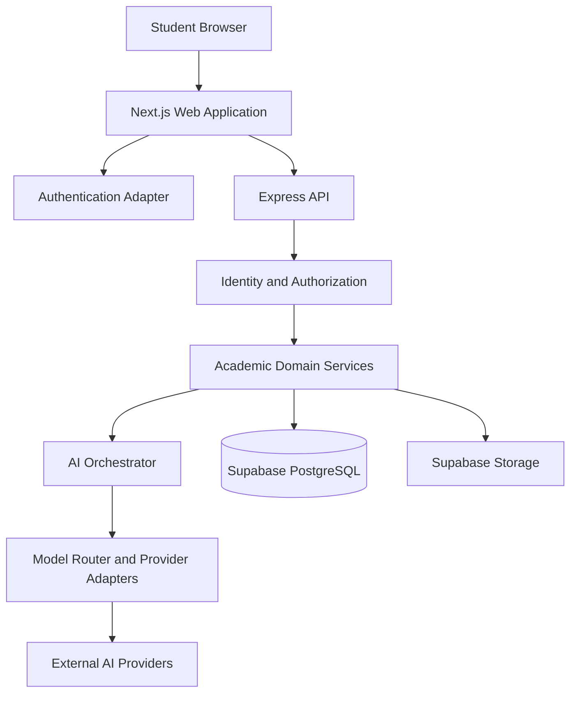
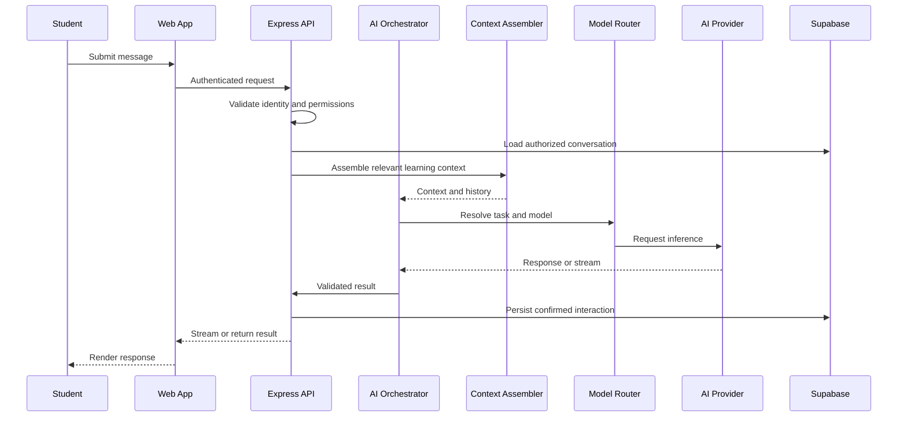

# SharpMind Web Application Architecture

**Document type:** Architecture specification for Antigravity  
**Project:** SharpMind — AI Academic OS  
**Scope:** Web application only  
**Status:** Proposed implementation architecture based on the existing repository  
**Repository:** `ashishsoni145/SharpMind`

---

## 1. Purpose

SharpMind is an AI-powered academic operating system designed to help students understand their knowledge, identify learning gaps, plan study sessions, practice questions, revise effectively, and measure exam readiness.

The immediate objective is to recover, stabilize, and complete the existing web application before developing desktop applications, mobile applications, or CLI tools.

This document establishes the architecture, boundaries, implementation priorities, security requirements, and verification criteria that Antigravity must follow.

### Core principle

**Build on the existing codebase. Do not replace it with a new starter application.**

Antigravity must inspect the implementation before changing it, preserve working functionality, and distinguish verified functionality from planned functionality.

## 2. Product scope

### In scope

- Public landing pages and product information
- User registration, authentication, and account recovery
- Student onboarding and academic preferences
- Personalized student dashboard
- AI tutor and persistent conversations
- Student knowledge model
- Diagnostic assessments and practice questions
- Adaptive study planning
- Revision and spaced repetition
- Mistake tracking and analysis
- Exam readiness
- Learning materials and file management
- Focus sessions
- Notifications
- Learning analytics and progress tracking
- Subscription and AI usage enforcement, where supported by the existing implementation
- Administrative and operational capabilities where already required by the product

### Out of scope for the current phase

- Native desktop applications
- Mobile applications
- CLI applications
- Distributed microservices
- Premature infrastructure expansion
- New payment integrations without an approved implementation plan

The architecture should remain extensible, but these future platforms must not delay completion of the web application.

## 3. Existing repository structure

The following structure has been verified from files in the repository. Antigravity must inspect the complete directory tree before assuming that every module is present or operational.

```text
SharpMind/
├── apps/
│   └── web/
│       ├── src/
│       │   ├── app/
│       │   │   ├── sections/
│       │   │   ├── layout.tsx
│       │   │   ├── metadata.ts
│       │   │   └── page.tsx
│       │   ├── components/
│       │   ├── lib/
│       │   │   ├── adapters/
│       │   │   ├── auth/
│       │   │   └── theme/
│       │   └── styles/
│       ├── next.config.ts
│       ├── package.json
│       └── tsconfig.json
├── backend/
│   ├── src/
│   │   ├── app.ts
│   │   ├── server.ts
│   │   ├── config/
│   │   ├── middleware/
│   │   ├── lib/
│   │   ├── db/
│   │   ├── ai/
│   │   └── modules/
│   ├── package.json
│   └── tsconfig.json
├── packages/
├── docs/
│   └── architecture/
│       └── adr/
├── package.json
├── package-lock.json
└── .env.example
```

This is a representative architecture map, not a guarantee that every listed directory is populated identically. Use the actual repository tree as the source of truth.

The root package defines npm workspaces for `apps/*`, `backend`, and `packages/*`.

## 4. Technology architecture

### Frontend

The existing web application uses:

- Next.js 15
- React 19
- TypeScript
- CSS Modules and shared styling
- Shared layout and UI components
- An authentication context and authentication adapter
- A theme provider
- Supabase JavaScript client dependencies

Preserve the existing component structure and conventions unless the audit demonstrates a concrete problem.

Do not introduce another UI framework or state-management library without establishing a clear need.

### Backend

The existing backend uses:

- Node.js
- Express
- TypeScript
- Supabase client
- Zod for schema validation
- Helmet for security headers
- CORS configuration
- Compression
- Pino logging
- Vitest and Supertest for testing

The backend is organized into domain modules and is the intended boundary for protected business logic.

### Database and managed services

Supabase is the initial persistence platform for PostgreSQL, authentication, and storage.

Inspect existing database migrations, tables, indexes, constraints, triggers, and row-level security policies before changing the schema.

Do not recreate the database or introduce a second persistence system without explicit architectural justification.

### AI integration

The existing backend includes:

- AI orchestration
- Context assembly and retrieval
- Tutor services and prompts
- AI provider configuration

The environment configuration includes Groq, Gemini, OpenRouter, and mock provider options.

Inspect the actual provider adapters and model router before deciding which provider is production-ready.

### Architecture style

Use a **modular monolith** for the backend.

Organize functionality into clear domain modules with explicit service boundaries. Do not split the application into microservices merely to make the architecture appear more advanced.

## 5. High-level system design



This diagram describes the intended logical architecture. Antigravity must verify actual runtime connections, API prefixes, authentication flows, and provider implementations.

### Responsibility boundaries

**Web application**

- Rendering and navigation
- User interaction
- Form validation for usability
- Loading, empty, success, and error states
- Presentation of authenticated user data
- Chat streaming interface
- Responsive design and accessibility

**Backend**

- Authoritative authentication checks
- Authorization and resource ownership
- Business rules and academic workflows
- Request validation
- AI orchestration and tool execution
- Usage metering and quota enforcement
- Database operations and persistence
- Rate limiting, logging, and error handling

**Supabase**

- Persistent academic and account data
- Authentication services where configured
- File storage
- Database access policies and row-level security

**AI providers**

- Model inference
- Provider-specific streaming and tool-call responses
- Provider-reported usage and model metadata where available

## 6. Frontend architecture

### 6.1 App Router and layouts

Use the existing Next.js App Router structure.

Keep shared layout concerns in the existing layout and component layers. Organize routes by user journey and product domain.

Separate public and authenticated experiences logically, using route groups or layouts where appropriate.

Potential route organization:

```text
src/app/
├── page.tsx
├── product/
├── features/
├── get-started/
├── login/
├── signup/
├── dashboard/
├── tutor/
├── assessments/
├── planner/
├── revision/
├── mistakes/
├── materials/
├── focus/
├── analytics/
└── settings/
```

This is a target route proposal, not a claim that these routes already exist. Inspect the current routes and reuse existing implementations before adding or renaming anything.

### 6.2 Shared components

Keep reusable UI components in the existing component hierarchy.

Use shared components for:

- Buttons and form controls
- Cards and panels
- Navigation and sidebars
- Dialogs and confirmation flows
- Toasts and feedback
- Loading skeletons
- Empty states
- Error states
- Tables and lists
- Progress indicators
- Chat messages and composer controls

Avoid duplicating components across academic modules.

### 6.3 Design system

Establish one consistent design system with:

- Typography and type scale
- Spacing tokens
- Color tokens
- Surface and border treatments
- Shadows and elevation
- Radius conventions
- Focus and hover states
- Responsive breakpoints
- Motion and animation conventions

The interface should feel like a polished educational product, not a generic AI dashboard.

Visual quality must not come at the expense of readability, keyboard accessibility, performance, or usability.

Do not redesign every page before understanding the current implementation and confirming the design direction.

### 6.4 Client state

Use local component state for isolated interactions.

Use shared context only for genuinely application-wide state, such as authentication and theme.

Use the existing API client or adapter abstractions for backend communication if they are suitable. Do not create competing API clients for the same responsibility.

Persist important academic state in the backend rather than relying on browser storage.

Browser storage may be used for non-sensitive preferences, drafts, and other appropriate client-only state.

## 7. Frontend-to-backend communication

Use a single documented API boundary for protected academic operations.

The existing Express application uses an API prefix configured through backend environment settings. Inspect the actual configuration and route mounting before documenting or hardcoding a final production URL.

Recommended conventions:

- Validate all incoming request payloads.
- Return consistent success and error envelopes.
- Use appropriate HTTP status codes.
- Avoid exposing database errors, internal stack traces, or provider secrets.
- Apply request timeouts and cancellation where appropriate.
- Support streaming responses for AI interactions.
- Handle expired sessions and unauthorized responses consistently.
- Avoid duplicate submissions for operations that create assessments or record results.
- Add pagination to potentially large collections.
- Use request identifiers for tracing failures.

Keep API base URLs in environment configuration.

Do not hardcode development URLs throughout components.

## 8. Authentication and authorization

The existing frontend contains an authentication context and adapter. The backend contains authentication, identity, and authorization middleware.

Preserve these abstractions where they are correct.

### Required behavior

1. Restore existing sessions reliably.
2. Support registration, login, logout, verification, and password recovery where implemented.
3. Validate authentication on protected backend routes.
4. Resolve the authenticated user's identity consistently.
5. Enforce ownership for sessions, materials, assessments, plans, and other private resources.
6. Never trust a client-provided user ID as proof of identity.
7. Ensure that one student cannot access another student's records.
8. Handle revoked, expired, or invalid sessions safely.

Frontend route protection improves user experience but is not a replacement for backend authorization.

If Supabase Auth is the active identity provider, verify token validation and session handling on both frontend and backend.

## 9. Database and persistence

Before making schema changes, inspect all migrations and compare them with the existing database schema where access is available.

### Persistence principles

- Use migrations for schema changes.
- Preserve existing data.
- Add appropriate foreign keys, constraints, and indexes.
- Enforce ownership and access rules.
- Use transactions or equivalent atomic operations for related writes.
- Make retryable operations idempotent where appropriate.
- Use pagination for lists.
- Store timestamps consistently.
- Validate relationships between academic entities.
- Avoid storing duplicate copies of canonical state without a defined reason.

### Security requirements

- Never expose the Supabase service-role key to the browser.
- Use public client keys only in their intended role.
- Keep privileged database operations server-side.
- Verify row-level security policies for every user-owned table.
- Do not assume that possession of a UUID grants access.
- Test cross-user access explicitly.
- Do not disable row-level security to make a feature work.
- Do not run destructive production migrations without approval.

The exact table design must be derived from existing migrations and domain models rather than invented independently.

## 10. AI agent architecture

The AI agent must be treated as a backend capability with a user-facing interface, not as a standalone chat widget.

### 10.1 Existing foundation

The tutor service imports an AI orchestrator and a context assembler. The tutor API also uses authentication and resource-ownership middleware.

Antigravity must trace these existing components before implementing another orchestration layer.

### 10.2 Target execution flow



The actual ordering of persistence and streaming must be chosen carefully so that interrupted requests do not leave misleading or inconsistent conversation state.

### 10.3 Model gateway

Use a common internal interface for model providers.

Provider adapters should normalize:

- Message formats
- Streaming events
- Tool-call responses
- Token usage
- Model identifiers
- Timeout behavior
- Provider errors
- Rate-limit errors

The model router should select a model according to task suitability, configured availability, cost, latency, and access policy.

Do not invent provider capabilities or assume every model supports tools, streaming, or structured output.

### 10.4 Agent tools

The agent may eventually support validated actions such as:

- Create or update a study plan
- Generate a practice set
- Retrieve relevant learning materials
- Record a completed assessment
- Review previously recorded mistakes
- Recommend revision tasks
- Summarize academic progress

Only expose tools backed by real, implemented backend services.

Every tool must have a schema, authorization checks, argument validation, and controlled error handling.

Treat model-generated tool arguments as untrusted input.

Require explicit user confirmation for consequential operations where appropriate.

Never allow an LLM to bypass application permissions or issue arbitrary database queries.

### 10.5 Conversation management

Support:

- Persistent tutor sessions
- Message history
- Session ownership
- Subject and topic context
- Conversation titles
- Error recovery
- Safe retries
- Appropriate context-window management

Do not repeatedly send the entire historical conversation if a smaller, relevant context is sufficient.

### 10.6 Production AI configuration

Use server-side environment variables for provider configuration.

The existing configuration supports provider selection for Groq, Gemini, OpenRouter, and mock mode. Verify actual adapter implementations before enabling them.

Required behavior:

- No provider secrets in browser bundles.
- No mock AI responses in normal production operation.
- No fake success when a provider fails.
- Explicit handling of missing credentials.
- Bounded retries and timeouts.
- Safe handling of rate limits.
- Provider fallback only when configured and appropriate.
- Clear distinction between generated content and persisted actions.

## 11. Usage metering and subscriptions

Inspect existing usage and subscription implementations before adding new tables or billing services.

### Requirements

- Enforce limits on the server.
- Track usage per authenticated user and relevant billing period.
- Distinguish input tokens, output tokens, provider-reported usage, and estimated cost.
- Use actual provider usage where available.
- Avoid double-counting retries and duplicate submissions.
- Prevent concurrent requests from exceeding limits through race conditions.
- Define behavior when usage records cannot be persisted.
- Separate application allowances from provider billing.
- Never trust token counts or quota values submitted by the browser.
- Keep subscription entitlements and payment verification authoritative on the backend.

A usage progress bar in the frontend is only a representation of server-calculated usage. It must never enforce the limit itself.

Do not implement new payment flows or change live entitlements without explicit approval.

## 12. Academic domain modules

The existing Express application registers modules for multiple academic workflows, including users, onboarding, files, search, curriculum, knowledge graphs, questions, student models, diagnostics, planning, revision, assessments, mistakes, readiness, tutoring, materials, focus, analytics, and notifications.

Audit each module and map its actual dependencies before modifying it.

For each module, establish:

- API routes
- Request and response schemas
- Controller responsibilities
- Service-layer logic
- Database dependencies
- Authentication and ownership rules
- UI integration
- Tests
- Missing behavior

Prefer domain services that can be reused by the AI agent and the web interface without duplicating business logic.

Do not claim a workflow is complete just because its route exists.

## 13. File uploads and learning materials

Verify the current storage implementation and supported file types.

Required safeguards include:

- File size limits
- File-type validation
- Authorization on upload and download
- Safe object naming
- Private storage for private materials
- Time-limited signed URLs where suitable
- Validation before processing uploaded content
- Clear processing and failure states
- Resource cleanup policies

Do not expose private files through publicly accessible storage by default.

## 14. Error handling, logging, and observability

Use the existing backend logging and error-handling utilities.

Record enough information to diagnose failures without logging credentials, sensitive student content, session tokens, or unnecessary personal information.

Track relevant operational metrics such as:

- Request latency
- Error rate
- AI provider latency
- Provider failures and rate limits
- AI token usage and estimated cost
- Database failures
- Quota rejections
- Authentication and authorization failures

Return safe, actionable error messages to the frontend.

Avoid leaking stack traces and internal implementation details in production.

## 15. Deployment architecture

The target deployment must support the selected frontend rendering strategy and the backend API.

The repository's current `apps/web/next.config.ts` contains `output: 'export'`, indicating a static-export configuration.

**This is an architectural decision that must be verified before deployment.**

Antigravity must determine:

1. Whether the frontend actually requires Next.js server-side features.
2. Whether the existing export configuration is intentional.
3. Whether authentication and all required routes work under static export.
4. Whether the frontend communicates with the deployed Express API correctly.
5. Whether the hosting provider supports the selected deployment model.
6. Whether image optimization, routing, rewrites, and runtime environment variables are compatible.

Do not remove static export automatically. Do not retain it automatically either. Decide based on the existing implementation and target hosting requirements.

### Environment separation

Maintain separate development, staging, and production configuration.

Document required environment variable names and safe examples.

Never commit real credentials.

Verify production CORS origins, API URLs, callback URLs, and domain configuration.

The repository metadata currently references `https://sharpmind.app`. Verify the intended canonical domain before changing metadata, OAuth callbacks, or deployment settings.

## 16. Security baseline

All implementation work must respect these requirements:

- Server-side authentication and authorization
- Database row-level security
- Resource ownership checks
- Validated request bodies, query parameters, and path parameters
- Rate limiting for expensive and sensitive operations
- Secure CORS configuration
- Security headers
- Protected provider credentials
- Safe file handling
- No arbitrary model-directed database access
- No untrusted HTML rendering
- No production mock fallback
- No fake persisted state
- No secrets in source control or logs
- Dependency and vulnerability checks
- Explicit handling of errors and partial failures

Security fixes must not weaken existing protections for the sake of passing a test.

## 17. Performance and accessibility

The web application should:

- Load essential content quickly.
- Minimize unnecessary client-side JavaScript.
- Use appropriate dynamic imports for heavy features.
- Avoid repeated API requests.
- Paginate large collections.
- Cache only data that is safe to cache.
- Avoid caching private student data across users.
- Support responsive layouts.
- Support keyboard navigation.
- Provide visible focus indicators.
- Use semantic HTML and accessible form labels.
- Respect reduced-motion preferences.
- Display useful loading, empty, and error states.
- Prevent duplicate form submissions.

Measure actual performance before introducing caching layers or infrastructure changes.

## 18. Testing strategy

Use the existing TypeScript, Vitest, and Supertest tooling where applicable.

### Unit tests

Test business rules, validation, mapping functions, usage calculations, and model-routing behavior.

### Integration tests

Test API controllers, services, persistence boundaries, authentication middleware, and AI-provider adapters.

### Security tests

Test:

- Missing or invalid authentication
- Cross-user resource access
- Invalid payloads
- Unauthorized tool calls
- Usage-limit enforcement
- Concurrent duplicate submissions
- Secret exposure
- Unsafe file access

### Frontend tests

Verify key forms, navigation, loading states, API error handling, and authenticated user workflows.

### End-to-end tests

At minimum, verify the following user journey where implemented:

1. Open the public landing page.
2. Register or sign in.
3. Complete onboarding.
4. Open the dashboard.
5. Start an AI tutor session.
6. Send a message and receive a real provider response.
7. Verify that the session persists.
8. Generate or open a study plan.
9. Complete a practice or assessment workflow.
10. Verify saved progress.
11. Sign out and confirm protected pages are no longer accessible.

Do not substitute mocked provider success for a real AI integration test. If credentials are unavailable, report the limitation explicitly and run isolated tests for the rest of the system.

## 19. Implementation phases

### Phase 0 — Audit and preservation

- Inspect the entire repository.
- Inspect Git status, branch, remotes, and local changes.
- Map routes, modules, schemas, and dependencies.
- Run existing tests and builds where possible.
- Identify missing environment configuration.
- Document defects and risks.
- Establish a recoverable checkpoint.

**Exit criteria:** A verified baseline and a prioritized implementation plan.

### Phase 1 — Application foundation

- Resolve dependency and build issues.
- Establish reliable local development.
- Verify routing and API configuration.
- Verify environment loading.
- Establish shared error handling.
- Verify authentication boundaries.

**Exit criteria:** The web frontend and backend run reliably in development, with no unresolved critical build errors.

### Phase 2 — UI and user experience

- Audit the current UI before redesigning.
- Finalize design tokens and reusable components.
- Complete public and authenticated layouts.
- Repair nonfunctional buttons, forms, and navigation.
- Implement responsive and accessible states.
- Connect screens to real data.

**Exit criteria:** Core navigation and user workflows work without dead controls or fake data.

### Phase 3 — Backend and persistence

- Verify schema and migrations.
- Verify row-level security and authorization.
- Complete core academic workflows.
- Validate API contracts.
- Ensure persistence and idempotency where necessary.

**Exit criteria:** Core operations are persisted correctly and access-control tests pass.

### Phase 4 — AI agent

- Audit and repair the existing orchestrator.
- Verify provider adapters and model routing.
- Implement reliable streaming.
- Connect authorized learning context.
- Validate tool execution.
- Implement or repair usage accounting.
- Verify provider failures and fallback behavior.

**Exit criteria:** The tutor produces real provider responses, maintains authorized context, persists confirmed operations, and respects quotas.

### Phase 5 — Production readiness

- Run full tests and production builds.
- Review security and dependency risks.
- Verify deployment compatibility.
- Test production-like authentication and API configuration.
- Validate critical workflows in a browser.
- Document remaining risks.

**Exit criteria:** Production readiness is supported by actual test results, not assumptions.

## 20. Antigravity execution rules

Antigravity must:

1. Read this document and the existing architecture decision records before implementing changes.
2. Audit the actual code before proposing replacements.
3. Produce a findings report before beginning broad refactoring.
4. Work incrementally in a dedicated recovery branch.
5. Preserve existing behavior unless a verified defect requires a change.
6. Avoid unrelated formatting changes and broad dependency upgrades.
7. Avoid parallel edits to the same files.
8. Run relevant checks after each logical change.
9. Report the exact commands executed and their results.
10. Distinguish verified success, partial completion, and unverified behavior.
11. Never claim that an integration works without testing it or clearly identifying the test limitation.
12. Never push commits or alter production infrastructure without authorization.
13. Never perform destructive database changes without approval.

## 21. Definition of done

The web application is ready for release only when:

- The application builds successfully.
- The backend type-checks and its test suite passes.
- The critical frontend and backend workflows work.
- Authentication and resource ownership are verified.
- Database security policies are tested.
- The AI tutor uses a real configured provider in production.
- AI responses and tool actions handle failures honestly.
- Usage limits are enforced on the server.
- No provider secrets are exposed to the client.
- Core student workflows persist correctly.
- Responsive and accessibility checks are completed.
- Deployment settings match the actual application architecture.
- Known limitations and operational requirements are documented.

Passing a build alone is not proof of production readiness.

---

**Final directive:** Stabilize and complete the existing SharpMind web application first. Reuse sound architecture, repair real defects, verify integrations, and introduce new abstractions only when they solve a demonstrated problem.
